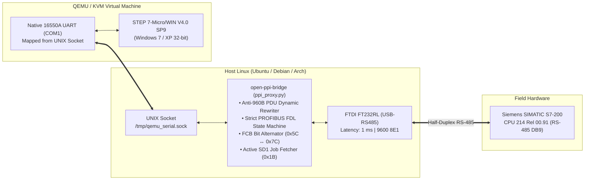

# open-ppi-bridge

[](LICENSE)
[](https://www.python.org/)
[](docs/pinout_and_hardware.md)
[]()

> **Full Program Block Download and Real-Time PPI Communication Bridge for legacy Siemens SIMATIC S7-200 PLCs using cheap generic USB-to-RS485 converters (FTDI FT232RL / CH340).**  
> *No expensive proprietary Siemens PC/PPI cable ($400 USD) required.*

---

## 🌟 Overview

The **Siemens SIMATIC S7-200** (especially 1st Generation models like the **CPU 214 Rel 00.91**) is a robust industrial workhorse. However, modern engineers face two major roadblocks:
1. **The Proprietary Cable Monopoly:** Siemens manuals state that communicating with an S7-200 requires an original *Siemens PC/PPI Multi-Master cable* (`6ES7 901-3CB30-0XA0`), costing over $350–$500 USD.
2. **The 240-Byte PDU Crash:** Connecting a generic USB-to-RS485 adapter directly to a virtual machine running STEP 7-Micro/WIN fails. Micro/WIN attempts to negotiate a modern 960-byte PDU buffer, causing early S7-200 firmware to crash or abort with *"Unknown communication error"* or *"Internal coordination violation (`0xD240`)"*.

`open-ppi-bridge` solves this permanently. It is a lightweight, serialized **Man-In-The-Middle (MITM) Smart Proxy** running in Linux that bridges virtualized Windows (QEMU/KVM) to the physical RS-485 bus, filtering fatal PDU packets, managing strict PROFIBUS FDL state machines, and enabling **100% successful program upload and download directly to the autómata**.

---

## 🛠️ Architecture



---

## ✨ Key Features

* **Complete Program Block Download (0% to 100%):** Downloads OB1, DB, and Subroutines into real S7-200 EEPROM without timing out.
* **Anti-960B PDU Negotiation Interceptor:** Rewrites incoming 960-byte requests to the exact 240-byte limit supported by 1st Gen CPU 214 hardware.
* **Active SD1 PLC Job Fetching:** Actively polls the PLC in `ST_IDLE` to capture unsolicited PLC Job requests (Function `0x1B _DOWN`) after block insertion (`_INSE`).
* **Strict FCB Bit Alternation:** Guards against redundant toggling, guaranteeing sequential alternation between `0x5C` and `0x7C` across code chunks.
* **Instant `_ENDB` Completion:** Instantly finalizes block transfers upon link ACK (`0xE5`), allowing sub-10ms dispatch of the block activation command (`_INSE`) before Micro/WIN's 3-second driver watchdog trips.
* **Standalone Linux CLI Suite:** Read inputs/outputs, monitor memory, scan station addresses, and toggle RUN/STOP without launching Windows or Micro/WIN.

---

## 🔌 Hardware Wiring (DB9 Female to USB-RS485)

Connect the front DB9 female port of the S7-200 to your generic RS-485 transceiver:

| S7-200 DB9 Pin | Signal Name | Adapter Pin (FTDI / MAX485) | Note |
| :---: | :---: | :---: | :--- |
| **Pin 3** | **RS-485 B (Data +)** | **A+ / D+** | Non-inverting data |
| **Pin 8** | **RS-485 A (Data -)** | **B- / D-** | Inverting data |
| **Pin 5** | **GND (Signal Ground)** | **GND** | **Mandatory:** Prevents common-mode saturation |

> [!CAUTION]
> Always connect **Pin 5 to GND**. Without a shared signal ground, differential line receivers will experience floating voltages and drop packets intermittently.

### FTDI Latency Timer Configuration
The S7-200 requires responses within 35 ms. In Linux, reduce the USB latency timer from 16 ms to 1 ms:

```bash
# Set low latency
echo 1 | sudo tee /sys/bus/usb-serial/devices/ttyUSB0/latency_timer
sudo setserial /dev/ttyUSB0 low_latency
```

---

## 🚀 Quickstart Guide

### 1. Installation
Clone the repository and install dependencies:

```bash
git clone https://github.com/humbertogamez23/open-ppi-bridge.git
cd open-ppi-bridge
pip install -r requirements.txt
```

### 2. Standalone Bus Scanner (Linux CLI)
Verify physical communication directly from Linux:

```bash
python3 scripts/scan_ppi.py
```
*Expected output:*
```text
============================================================
 ESCÁNER DE ESTACIONES SIEMENS PPI
 Puerto:   /dev/ttyUSB0 | 9600 bps, 8E1
============================================================
Buscando estación 01...
[+] [RESPUESTA] Estación 02 respondió: 10 00 02 00 02 16
[✓] Se encontraron 1 estación(es) activa(s):
   -> Dirección PLC: 2
```

### 3. Remote CPU Control (RUN / STOP)
Switch operational modes without Micro/WIN:

```bash
# Put PLC in STOP
python3 scripts/plc_control.py stop

# Put PLC in RUN
python3 scripts/plc_control.py run
```

### 4. Running the Smart Proxy with STEP 7-Micro/WIN (QEMU/KVM)

1. **Start the Proxy:**
   ```bash
   python3 scripts/ppi_proxy.py
   ```
   *The proxy will initialize communication with the PLC, negotiate 240B PDU, and listen on `/tmp/qemu_serial.sock`.*

2. **Launch Windows 7 in QEMU:**
   Start your virtual machine mapping the serial socket as native `COM1`:
   ```bash
   qemu-system-x86_64 -enable-kvm -m 2048 \
       -drive file=win7.qcow2,format=qcow2 \
       -chardev socket,id=serial0,path=/tmp/qemu_serial.sock \
       -serial chardev:serial0
   ```
   *(Or use our helper template: [`vm/start_qemu_example.sh`](vm/start_qemu_example.sh)).*

3. **In STEP 7-Micro/WIN:**
   * Go to **Ajustar interfaz PG/PC** $\rightarrow$ Select **PC/PPI cable (COM1)** $\rightarrow$ Properties: `9600 bps`, Station `0`.
   * Open your project and ensure the PLC front switch is in **STOP** (or **TERM**).
   * Click **Cargar en CPU (Download)** $\rightarrow$ Select `[✔] Bloque de programa` $\rightarrow$ Click **Cargar**.
   * Micro/WIN will display: **"La carga en CPU ha finalizado con éxito"**.

---

## 🔬 Protocol Diagnostics & S7comm Error Codes

During development, packet-level auditing on physical hardware uncovered critical insights documented in [`docs/protocol_specification.md`](docs/protocol_specification.md):

| Error Code | Error Description | Root Cause Identified & Resolved |
| :---: | :--- | :--- |
| **`0xD230`** | *Structural error in block* | Micro/WIN project contained a `CALL SBR1` referencing an empty subroutine block. Resolved by stripping empty blocks prior to compilation. |
| **`0xD240`** | *Internal coordination violation* | Occurred when Bytecode Chunk 1 was sent with duplicate `FC=0x5C`. Resolved in v8.5 by strictly alternating FCB to `0x7C` following `_INSE`. |
| **Timeout (3s)** | *Error de comunicación: revise el cable* | Micro/WIN driver timed out after 3.0s when proxy polled after `_ENDB`. Resolved in v8.6 by immediately closing on link ACK `0xE5`. |

---

## 📱 Mobile HMI for Industrial Gas Burner (Android APK)

An industrial **Pocket HMI** built with **Flutter** connects wirelessly to the **ESP32-S3** bridge via Bluetooth Low Energy (Nordic UART Service) to monitor and control a **Siemens S7-200 (CPU 214)** controlling an industrial gas burner:
* **Real-time digital I/O monitoring:** 14 digital inputs ($I0.0 \dots I1.5$) and 10 digital outputs ($Q0.0 \dots Q1.1$).
* **Star-Delta Blower & Pre-purge Sequence:** Visual tracking of motor contactors ($Q0.0$ Line, $Q0.1$ Star, $Q0.2$ Delta) and safety purge timer ($T63 / VW102$).
* **Analog Potentiometers:** Live gauges for $SMB28$ (Star time) and $SMB29$ (Pre-purge time).
* **Industrial Safety Controls:** Secured RUN/STOP switching with modal confirmation.
* Full documentation available in [`docs/mobile_hmi_and_gas_burner_architecture.md`](docs/mobile_hmi_and_gas_burner_architecture.md).
* Pre-compiled APK: [`Siemens_S7_HMI_Mobile.apk`](app/s7_hmi_mobile/build/app/outputs/flutter-apk/app-release.apk).

---

## 🗺️ Roadmap: Standalone Flashing & ESP32-S3

* [x] Reverse-engineer complete S7comm / PPI block download sequence.
* [x] Real-time Man-In-The-Middle proxy for QEMU/Micro/WIN (v8.6).
* [x] Linux CLI for I/O reading, memory inspection, and RUN/STOP.
* [x] **ESP32-S3 BLE Hardware Retrofit (`S7-200-PPI-BLE`):** Standalone firmware exposing Nordic UART Service over physical RS-485.
* [x] **Mobile Industrial HMI (Flutter Android APK):** Native pocket HMI for remote monitoring and burner control.
* [ ] **Gas Burner Sequence Completion (`SBR1`):** Ignition spark electrode, gas solenoid valves, and flame rectification/optical detection.
* [ ] **Remote Parameter Tuning:** Direct write to $VW$ memory over BLE to adjust purge and ignition timings from the phone.
* [ ] **Standalone Linux Flasher (`flash_s7_200.py`):** Flash pre-compiled `.bin` / `.awl` blocks directly from Linux terminal with zero Windows/QEMU dependency.

---

## 📄 License

This project is licensed under the **GNU General Public License v3.0** (GPL-3.0) — see the [LICENSE](LICENSE) file for details. Any derivative works must remain free and open source.

---

## 👤 Author & Acknowledgments

* **Lead Engineer:** Humberto Gámez ([@humbertogamez23](https://github.com/humbertogamez23))
* **Pair Programming & Architecture:** Antigravity AI (Google DeepMind)
* **Dedicated to:** Open-source industrial automation and retro-computing communities worldwide.
