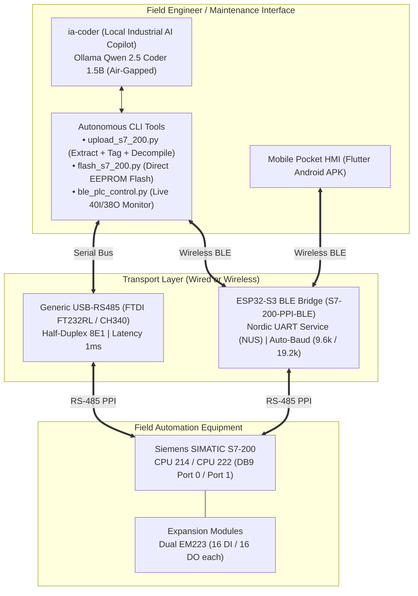
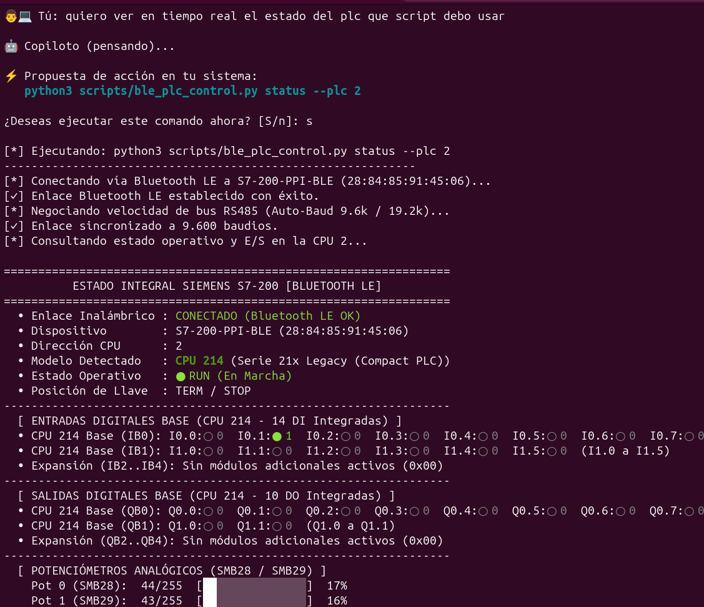
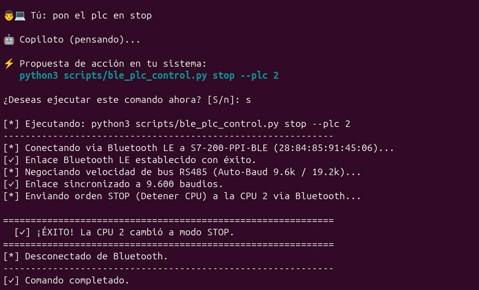
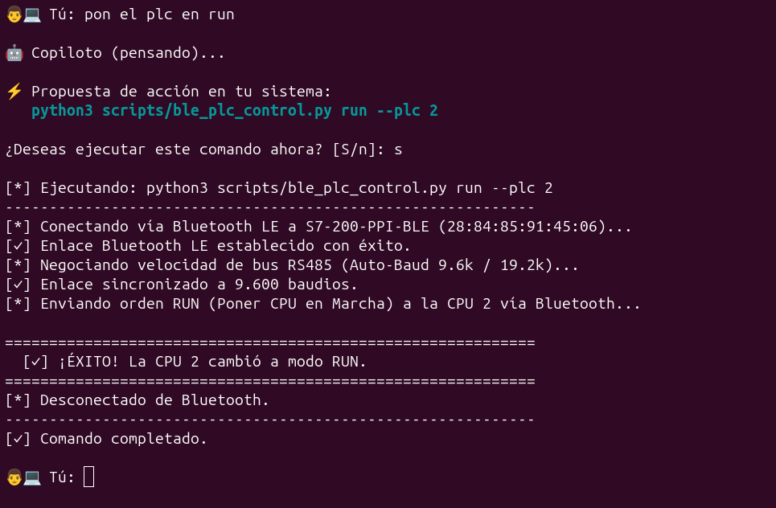

# open-ppi-bridge

[](https://github.com/humbertogamez23/open-ppi-bridge/releases/tag/v1.1.0)
[](LICENSE)
[](https://www.python.org/)
[-orange.svg)](docs/pinout_and_hardware.md)
[]()

> **Autonomous Programming, Upload/Flash Suite, Wireless Mobile HMI, and Local AI Copilot for legacy Siemens SIMATIC S7-200 PLCs over wireless BLE (ESP32-S3) and generic USB-to-RS485 converters.**  
> *Zero dependency on expensive proprietary Siemens PC/PPI cables ($400+ USD) or legacy Windows XP/7 virtual machines.*

---

## 🌟 Overview

The **Siemens SIMATIC S7-200** (CPU 21x and 22x series, e.g., **CPU 214**, **CPU 222**) is one of the most reliable and prevalent industrial micro-PLCs in manufacturing plants worldwide. However, maintenance engineers face major obstacles today:
1. **The Proprietary Cable Monopoly:** Siemens manuals state that communicating with an S7-200 requires an original *Siemens PC/PPI Multi-Master cable* (`6ES7 901-3CB30-0XA0`), costing over $350–$500 USD.
2. **The 240-Byte PDU Crash:** Generic USB-to-RS485 adapters fail when connected directly to virtualized STEP 7-Micro/WIN due to a 960-byte PDU buffer negotiation bug that crashes early S7-200 firmware (`0xD240`).
3. **Legacy Windows Lockdown:** Traditional maintenance requires maintaining obsolete 32-bit Windows XP / Windows 7 environments solely to run STEP 7-Micro/WIN.

`open-ppi-bridge` eliminates these barriers. It is a complete open-source ecosystem running on modern Linux:
* **Standalone Autonomous Flasher & Extractor (`flash_s7_200.py` / `upload_s7_200.py`):** Extract, disassemble, compile, and flash program blocks (OB1, DB1, SDB) directly from Linux terminal over wired RS-485 or wireless Bluetooth LE without Micro/WIN.
* **Local Offline AI Copilot (`ia-coder`):** An industrial engineering assistant running locally via Ollama (`qwen2.5-coder:1.5b`), featuring multi-turn conversation memory, safety interlock auditing, parameter auto-guidance, and code generation.
* **Smart MITM Serial Proxy (`ppi_proxy.py`):** Enables 100% reliable uploads/downloads for users who still need to run STEP 7-Micro/WIN in QEMU/KVM.
* **High-Density Live I/O & Hardware Diagnostics (`ble_plc_control.py`):** Real-time monitoring of up to 40 digital inputs and 38 digital outputs with dual EM223 modules over BLE.

---

## 🛠️ Architecture



---

## ✨ Key Features

* **Autonomous Program Extraction (`upload_s7_200.py`):** Extracts OB1, DB1 (decompresses V-memory), and SDB blocks. Includes unique timestamped auto-naming with machine tags (`--tag contexxor`) and automatic AWL disassembly (`--awl`).
* **Standalone Linux Flasher (`flash_s7_200.py`):** Flashes pre-compiled binary blocks directly into physical S7-200 EEPROM in **0.9s via wired RS-485** or **3.2s via BLE (ESP32-S3)**.
* **Local Industrial AI Copilot (`ia-coder`):** Offline terminal assistant for automated logic generation, safety audits, and interactive CLI execution. Talks first, explains reasoning, asks clarifying questions, and manages flags before executing.
* **Dual Auto-Baudrate Negotiation (9.6k & 19.2k):** Universal support across 1st Gen (CPU 21x at 9600 bps) and 2nd Gen (CPU 22x at 19200 bps or 9600 bps).
* **Massive Live I/O Monitoring:** Live multi-module tracking for up to **40 inputs and 38 outputs** with EM223 digital expansion modules.
* **Native AWL Assembler / Disassembler (`s7_awl_asm.py`):** Bidirectional compiler between binary bytecode (`FB 70 70`) and readable Statement List (AWL/STL).
* **Deterministic Scan-Cycle Simulator (`simulador_awl.py`):** Step-by-step logic simulator testing accumulators, timers, and interlocks on PC before touching live machines.
* **STEP 7-Micro/WIN Smart Proxy (`ppi_proxy.py`):** Filters fatal 960-byte PDUs and handles strict PROFIBUS FDL state machines for legacy QEMU/KVM virtual machines.

---

## 🚀 Quickstart Guide

### 1. Installation
Clone the repository and install the lightweight Python dependencies:

```bash
git clone https://github.com/humbertogamez23/open-ppi-bridge.git
cd open-ppi-bridge
pip install -r requirements.txt
```

*(Optional: Install and start Ollama with `ollama pull qwen2.5-coder:1.5b` to enable `ia-coder`).*

---

### 2. Standalone Bus Scanner (Discover Active PLCs)
Scan the PPI network to detect connected PLC stations:

```bash
# Scan via physical USB-RS485 cable
python3 scripts/scan_ppi.py -p /dev/ttyUSB0

# Scan wirelessly via ESP32-S3 Bluetooth LE
python3 scripts/ble_scan_ppi.py
```

---

### 3. Extracting Programs from PLC (`upload_s7_200.py`)
Download and decompile logic directly from physical hardware without Micro/WIN:

```bash
# Extract wirelessly via BLE, tag machine name, and audit with AI
python3 scripts/upload_s7_200.py --ble --plc 2 --tag contexxor --ai

# Extract via USB-RS485 cable
python3 scripts/upload_s7_200.py --port /dev/ttyUSB0 --plc 2 --tag telar1 --awl
```
*Generated files will be saved in `blocks/` with clickable local links (e.g. `file:///.../blocks/contexxor_ob1_20261106_013243.awl`).*

---

### 4. Flashing Programs to PLC (`flash_s7_200.py`)
Load compiled program blocks directly into S7-200 EEPROM:

```bash
# Flash program block (OB1) wirelessly and restart CPU in RUN mode
python3 scripts/flash_s7_200.py --ble --program --stop --run blocks/latest.bin

# Flash complete trilogy (System SDB + Program OB1 + Data DB1) via cable
python3 scripts/flash_s7_200.py --port /dev/ttyUSB0 --all
```

---

### 5. Live I/O Monitoring & CPU Diagnostics (`ble_plc_control.py`)
Interact with inputs, outputs, and internal registers in real time:

```bash
# Live continuous loop monitoring of 40 inputs and 38 outputs
python3 scripts/ble_plc_control.py io -w --plc 2

# Inspect CPU model, hardware version and SMB6 diagnostic registers
python3 scripts/ble_plc_control.py info --plc 2

# Read internal analog potentiometer (SMB28 / SMB29) or variable memory
python3 scripts/ble_plc_control.py read SMB28 --plc 2
python3 scripts/ble_plc_control.py read VW100 --plc 2

# Switch operational state
python3 scripts/ble_plc_control.py run --plc 2
python3 scripts/ble_plc_control.py stop --plc 2
```

---

### 6. Local Industrial AI Copilot (`ia-coder`)
Launch the private, air-gapped terminal assistant:

```bash
# Start interactive conversational session
ia-coder
# or: python3 scripts/ai_copilot.py --chat

# Audit an AWL file for race conditions and missing interlocks
python3 scripts/ai_copilot.py --audit blocks/latest.awl

# Explain complex networks in plain technical Spanish
python3 scripts/ai_copilot.py --explain blocks/latest.awl
```

*Inside `ia-coder`, you can converse naturally. It maintains memory, asks clarifying questions, advises on `--baud` or `--timeout` flags, and offers executable commands with `[s/N]` confirmation.*

#### 📸 Standalone Terminal & AI Copilot in Action (No Micro/WIN Required!)
You don't need to spin up a Windows virtual machine or open STEP 7-Micro/WIN for routine diagnostics, I/O verification, or operational switching. You can operate the autómata with plain natural language:

* **Live CPU Hardware Diagnostics & I/O Telemetry:**
  
  *Real-time CPU 214 model auto-detection, onboard digital inputs (`I0.1: ● 1`), outputs, and analog potentiometers ($SMB28$ / $SMB29$) streamed wirelessly over Bluetooth LE.*

* **Wireless Operational Control (STOP / RUN via Natural Language):**
  | Natural Language STOP (`pon el plc en stop`) | Natural Language RUN (`pon el plc en run`) |
  | :---: | :---: |
  |  |  |

---

### 7. Legacy STEP 7-Micro/WIN Virtual Machine & Smart Proxy (QEMU / KVM)
If you require original Siemens STEP 7-Micro/WIN in a Windows 7 virtual machine:

#### Quick Automated Setup (1 Command)
Having your Windows 7 ISO file ready, run the interactive installer wizard:
```bash
bash vm/setup_win7_vm.sh /path/to/windows7.iso
```
*It verifies KVM virtualization, creates the dynamic 30GB virtual disk, mounts the ISO, configures COM1 with the anti-960B proxy filter, and launches the Windows installer.*

#### Daily Usage
Once installed, start the virtual machine anytime:
```bash
# Wired RS-485 (FTDI / CH343)
bash vm/run_win7_vm.sh

# Or 100% wireless via Bluetooth LE
bash vm/run_win7_vm.sh --ble
```
* Inside Windows 7 Micro/WIN, select **PC/PPI cable (COM1)** at 9600 bps. Program upload and download will complete with 100% success.
* Exchange `.mwp` and `.awl` files effortlessly by browsing to `http://10.0.2.2:8000` inside the VM.
* See [vm/README.md](file:///home/gus05/open-ppi-bridge/vm/README.md) for full architecture details and troubleshooting.

---

## 🔌 Hardware Wiring (DB9 to USB-RS485)

Connect the front DB9 female port of the S7-200 to your generic RS-485 transceiver:

| S7-200 DB9 Pin | Signal Name | Adapter Pin (FTDI / MAX485) | Note |
| :---: | :---: | :---: | :--- |
| **Pin 3** | **RS-485 B (Data +)** | **A+ / D+** | Non-inverting data |
| **Pin 8** | **RS-485 A (Data -)** | **B- / D-** | Inverting data |
| **Pin 5** | **GND (Signal Ground)** | **GND** | **Mandatory:** Prevents common-mode saturation |

> [!CAUTION]
> Always connect **Pin 5 to GND**. Without a shared signal ground, differential line receivers will experience floating voltages and drop packets intermittently.

### Low Latency FTDI Setup (Linux)
Reduce the kernel USB latency timer from 16 ms to 1 ms:
```bash
echo 1 | sudo tee /sys/bus/usb-serial/devices/ttyUSB0/latency_timer
sudo setserial /dev/ttyUSB0 low_latency
```

---

## 📱 Mobile Industrial HMI (Flutter Android APK)

A mobile **Pocket HMI** built with **Flutter** connects wirelessly to the **ESP32-S3** bridge via BLE:
* **Digital I/O tracking:** Up to 40 inputs ($I0.0 \dots I4.7$) and 38 outputs ($Q0.0 \dots Q4.5$).
* **Star-Delta Burner Sequence Monitoring:** Motor contactors, safety purge timers ($T63$), and combustion stage status.
* **Gauges & Parameter Tuning:** Real-time displays for $SMB28$, $SMB29$, and variable memory.
* Pre-compiled APK: [`Siemens_S7_HMI_Mobile.apk`](app/s7_hmi_mobile/build/app/outputs/flutter-apk/app-release.apk).

---

## 📄 License

This project is licensed under the **GNU General Public License v3.0** (GPL-3.0) — see the [LICENSE](LICENSE) file for details.

---

## 👤 Author, Contact & Support

* **Lead Engineer:** Humberto Gámez ([@humbertogamez23](https://github.com/humbertogamez23))
* **Direct Contact & Community Support:**
  * ✈️ **Telegram:** [@ingGustav](https://t.me/ingGustav)
  * 💬 **WhatsApp:** `@gustav_gamez`
* **Pair Programming & Architecture:** Antigravity AI (Google DeepMind)
* **Dedicated to:** Open-source industrial automation and retro-computing communities worldwide.
