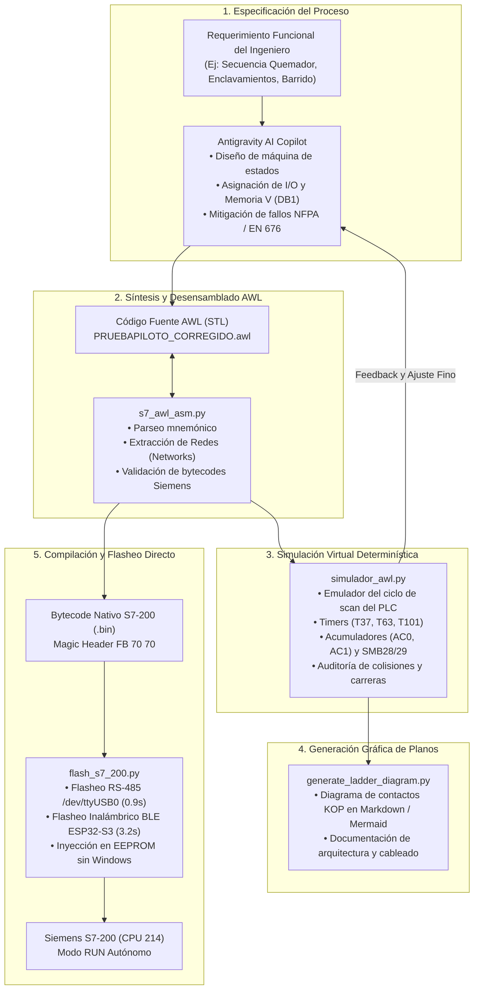

# Suite de Ingeniería de Lógica PLC y Flujo Asistido por Inteligencia Artificial (Antigravity AI)

El ecosistema **`open-ppi-bridge`** no es solo un puente de comunicación serie: integra una suite completa de herramientas de ingeniería inversa y desarrollo autónomo de lógica para autómatas **Siemens SIMATIC S7-200**, desarrollada en colaboración directa con **Antigravity AI (Google DeepMind)** mediante *Pair Programming*.

Esta arquitectura permite concebir, simular, ensamblar y transferir programas de control industrial (AWL / KOP) de manera 100% autónoma, eliminando por completo la necesidad de máquinas virtuales con Windows y licencias de software propietario como STEP 7-Micro/WIN.

---

## 🏗️ Los 5 Pilares del Flujo Asistido por IA

---

## 🛠️ Herramientas Integradas en la Suite

### 1. Desensamblador y Ensamblador Nativo (`scripts/s7_awl_asm.py`)
Permite decodificar bloques binarios descargados de la CPU o generados por Micro/WIN (`FB 70 70`) hacia texto plano mnemónico AWL/STL y viceversa.
* **Inspección de Encabezados:** Extrae metadatos de tipo de bloque (OB1, SDB, DB1), longitudes de código, offsets y contador de redes.
* **Reconocimiento de Opcodes:** Soporta instrucciones complejas de control de flujo (`CALL SBR_n`, `RET`, `ED D6`), operaciones de carga/movimiento de memoria (`MOVB`, `MOVW` sobre `AC`, `VW`, `SMB`), comparadores (`LDW<=`, `LDW>=`) y temporizadores (`TON`).

### 2. Simulador de Scan y Condiciones de Carrera (`scripts/simulador_awl.py`)
Antes de transferir un bloque a un autómata físico conectado a actuadores reales (como motores sopladores, electrodos de chispa o electroválvulas de gas), el simulador reproduce fielmente el ciclo de scan del autómata:
* **Lectura de imagen de entradas ($I$):** Simulación de pulsadores físicos y enclavamientos.
* **Gestión de memoria de variables ($V$):** Validación del auto-reset de bits virtuales (`V200.0`, `V200.1`) provenientes de la HMI móvil para evitar enclavamientos indeseados ante pérdida de señal Bluetooth.
* **Resolución de temporizadores industriales:** Emulación de base de tiempo de 100ms para temporizadores estrella-triángulo (`T37`) y purga previa (`T63`).
* **Detección temprana de errores:** Evita el destructivo error S7comm `0xD230` (*Structural error in block*) o `0xD240` (*Internal coordination rules violated*).

### 3. Generador de Diagramas de Contactos (`scripts/generate_ladder_diagram.py`)
Convierte automáticamente la estructura de instrucciones mnemónicas AWL en esquemas visuales de diagrama de contactos (Ladder / KOP) renderizables directamente en plataformas como GitHub, Obsidian o herramientas de soporte técnico.

### 4. Flasheador Headless y Remoto BLE (`scripts/flash_s7_200.py`)
La culminación del flujo de ingeniería: una herramienta de línea de comandos en Linux que ejecuta la secuencia completa de flasheo industrial mediante protocolo PPI/S7comm:
1. Conexión y lectura del bloque de estado del PLC.
2. Cambio seguro a modo **STOP** (`FC=0x29`).
3. Solicitud de borrado de bloque antiguo (`_DELE`).
4. Asignación de descriptor de bloque nuevo (`_CREA`).
5. Transferencia segmentada en chunks FDL con alternancia estricta del bit FCB (`0x5C` $\leftrightarrow$ `0x7C`).
6. Cierre de bloque (`_ENDB`) y confirmación de commit en EEPROM (`10 00 02 02 04 16`).
7. Inserción lógica (`_INSE`) y retorno automático a modo **RUN** con cabecera extendida de 11 bytes.
* **Velocidad:** Flasheo completo de un bloque OB1 en **0.9 segundos por cable RS-485** o en **3.2 segundos vía inalámbrica Bluetooth Low Energy**.

---

## 🤝 Cómo Trabajar Lógica con Antigravity AI

Cualquier ingeniero o desarrollador puede interactuar con Antigravity AI en este repositorio para:

1. **Diseñar Nuevas Secuencias de Automatización:**
   * Solicitar la creación o refactorización de subrutinas (ej. `SBR1` para tren de válvulas de gas, modulación de llama PID, o recetas de proceso).
2. **Revisar y Optimizar Tiempos de Scan:**
   * Ajustar la lógica para optimizar el direccionamiento de acumuladores (`AC0`/`AC1`) y rangos de memoria analógica (`SMB28`/`SMB29`).
3. **Validación Previa al Flasheo:**
   * Pedir al agente que ejecute pruebas sintéticas con `simulador_awl.py` para certificar que la lógica cumple con las normas de seguridad del proceso.
4. **Despliegue Asistido:**
   * Instruir al agente para flashear el autómata conectado físicamente a la estación de trabajo o a la pasarela inalámbrica ESP32-S3 y analizar las tramas capturadas con `sniffer_live.py`.
