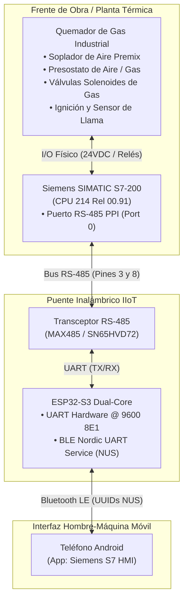

# Arquitectura de la HMI Móvil y Secuencia de Control de Quemador de Gas Industrial

Este documento detalla la integración técnica entre el autómata **Siemens SIMATIC S7-200 (CPU 214)**, el puente inalámbrico **ESP32-S3 BLE** y la aplicación móvil **Flutter HMI (`Siemens_S7_HMI_Mobile.apk`)**, aplicado específicamente al control seguro de un **quemador industrial de gas**.

---

## 1. Topología del Sistema



---

## 2. Lógica del Quemador de Gas (`PRUEBAPILOTO_CORREGIDO.awl`)

El programa del PLC implementa una secuencia de seguridad para combustión industrial basada en estándares internacionales (**NFPA 85 / EN 676**):

### 2.1 Asignación de Entradas y Salidas
| Identificador | Tipo | Elemento Físico en Quemador | Función Técnica de Seguridad |
| :---: | :---: | :--- | :--- |
| **`I0.0`** | Entrada | Pulsador de Marcha | Inicio de la secuencia de arranque del quemador. |
| **`I0.1`** | Entrada | Cadena de Paro / Seguridad | Lazo cerrado de presostatos y parada de emergencia. |
| **`I0.3`** | Entrada | Reset / Parada Temporizada | Enlace con temporizador de seguridad `T101`. |
| **`Q0.0`** | Salida | Contactor Principal de Línea | Alimenta el estator del motor soplador de aire premix. |
| **`Q0.1`** | Salida | Contactor Estrella ($Y$) | Conexión inicial de baja corriente de arranque. |
| **`Q0.2`** | Salida | Contactor Delta ($\Delta$) | Marcha plena del ventilador forzado a velocidad nominal. |
| **`Q0.4`** | Salida | Habilitación de Ignición | Activa el pase a `SBR1` tras completar la prepurga. |

---

### 2.2 Secuencia Operativa por Subrutinas

#### A. Calibración Analógica con Potenciómetros (`SBR2`)
El operario o técnico calibra físicamente los tiempos de arranque y barrido mediante los potenciómetros integrados en la CPU:
* **Potenciómetro 0 (`SMB28`):** Se escala y aplica *clamping* entre 15 y 195 ticks hacia **`VW100`**, definiendo el tiempo de transición Estrella $\rightarrow$ Delta (`T37`).
* **Potenciómetro 1 (`SMB29`):** Se escala y aplica *clamping* entre 15 y 195 ticks hacia **`VW102`**, definiendo el tiempo de **Prepurga de Seguridad (`T63`)**.

#### B. Arranque Estrella–Triángulo del Soplador (`SBR0`)
1. Se energiza `Q0.0` (Línea) y `Q0.1` (Estrella).
2. El temporizador `T37` cuenta hasta alcanzar `VW100`.
3. Al vencer `T37`, se abre `Q0.1` y se activa un tiempo de guarda de 600 ms (`T33`, base 10 ms con 60 ticks) para evitar arcos y cortocircuitos entre contactores.
4. Cumplido `T33`, entra el contactor Delta `Q0.2` con auto-retención.

#### C. Prepurga Forzada y Pase a Gas (`OB1` Networks 6–8)
1. Con el soplador girando en Delta a plena potencia (`Q0.2`), el flujo de aire barre la cámara de combustión.
2. Arranca el temporizador de prepurga `T63` configurado dinámicamente con `VW102`.
3. Al cumplirse el tiempo de purga, se energiza `Q0.4`.
4. `Q0.4` convoca la subrutina `SBR1` para la habilitación de la chispa de ignición y apertura de las válvulas de gas.

---

## 3. Protocolo de Comunicación Bluetooth LE (Nordic UART Service)

El firmware del **ESP32-S3** expone el servicio GATT estándar **NUS**:
* **Service UUID:** `6e400001-b5a3-f393-e0a9-e50e24dcca9e`
* **RX Characteristic (App $\rightarrow$ ESP32):** `6e400002-b5a3-f393-e0a9-e50e24dcca9e` (Propiedad: Write / Write Without Response)
* **TX Characteristic (ESP32 $\rightarrow$ App):** `6e400003-b5a3-f393-e0a9-e50e24dcca9e` (Propiedad: Notify)

### Estructura de Tramas S7comm / PPI:
1. **Petición SD2 (App a ESP32):**
   `[0x68, LEN, LEN, 0x68, PLC_ADDR(0x02), PC_ADDR(0x00), 0x4C, ...PDU_BODY..., FCS, 0x16]`
2. **Recepción de ACK Inmediato:** El PLC responde `0xE5`.
3. **Sondeo SD1:** La App envía periódicamente `[0x10, 0x02, 0x00, 0x4C, 0x4E, 0x16]`.
4. **Respuesta SD2:** El PLC envía la trama con los bytes solicitados (Entradas, Salidas, Marcas o Potenciómetros).

---

## 4. Aplicación Móvil en Flutter (`s7_hmi_mobile`)

Ubicación del código: [`open-ppi-bridge/app/s7_hmi_mobile/`](../app/s7_hmi_mobile/)

### Módulos Implementados:
* **`lib/services/ppi_protocol.dart`:** Motor matemático y generador de tramas SD1/SD2, PDU de lectura de memoria (`I`, `Q`, `SM`, `V`, `M`), conmutación de modo RUN/STOP y extractor de datos.
* **`lib/services/ble_service.dart`:** Administrador reactivo de enlace BLE mediante `flutter_blue_plus`, control de colas de paquetes, timeouts y bucle de refresco continuo (*polling* a 400 ms).
* **`lib/models/plc_state.dart`:** Estado global de la aplicación gestionado con `Provider`.
* **`lib/screens/hmi_dashboard.dart`:** Tablero visual industrial oscuro:
  * 14 LEDs circulares de Entradas Digitales ($I0.0 \dots I1.5$).
  * 10 LEDs circulares de Salidas Digitales ($Q0.0 \dots Q1.1$).
  * Botonera de mando **RUN** y **STOP** con diálogo de confirmación de seguridad.
  * Barras lineales dinámicas para los potenciómetros analógicos `SMB28` y `SMB29`.
  * Interruptor de monitoreo en vivo continuo.

---

## 5. Pipeline de Compilación del APK en Ubuntu Linux

Para compilar el archivo instalable de forma autónoma sin Android Studio:

```bash
# 1. Dependencias del sistema requeridas
sudo apt install -y openjdk-17-jdk

# 2. Variables de entorno en ~/.bashrc
export ANDROID_HOME="/home/gus05/Android/Sdk"
export PATH="$ANDROID_HOME/cmdline-tools/latest/bin:$ANDROID_HOME/platform-tools:$PATH"

# 3. Compilación de release optimizada
cd /home/gus05/open-ppi-bridge/app/s7_hmi_mobile
flutter build apk --release
```

El instalador final generado se ubica en:
* `/home/gus05/open-ppi-bridge/app/s7_hmi_mobile/build/app/outputs/flutter-apk/app-release.apk`
* `/home/gus05/Descargas/Siemens_S7_HMI_Mobile.apk`

---

## 6. Próximos Pasos (Roadmap del Quemador de Gas)

1. **`SBR1` (Subrutina de Ignición y Gas):**
   * Configuración de salidas para electrodo de chispa ($Q0.3$) y válvulas solenoide de gas ($Q0.4$ piloto, $Q0.5$ principal).
   * Verificación de permisivos de presión mediante presostatos ($I0.2$ aire, $I0.3$ gas).
2. **Personalización Visual de la HMI Móvil:**
   * Sustituir las etiquetas genéricas ($I/Q$) por los nombres funcionales de combustión.
   * Barra de estado de secuencia de combustión (Prepurga $\rightarrow$ Encendido $\rightarrow$ Llama $\rightarrow$ Régimen).
   * Temporizador regresivo en pantalla durante el conteo de `T63`.
3. **Escritura Remota de Parámetros:**
   * Permitir la modificación de tiempos de prepurga ($VW102$) y transición ($VW100$) directamente desde la pantalla táctil mediante comandos de escritura de memoria S7comm.
