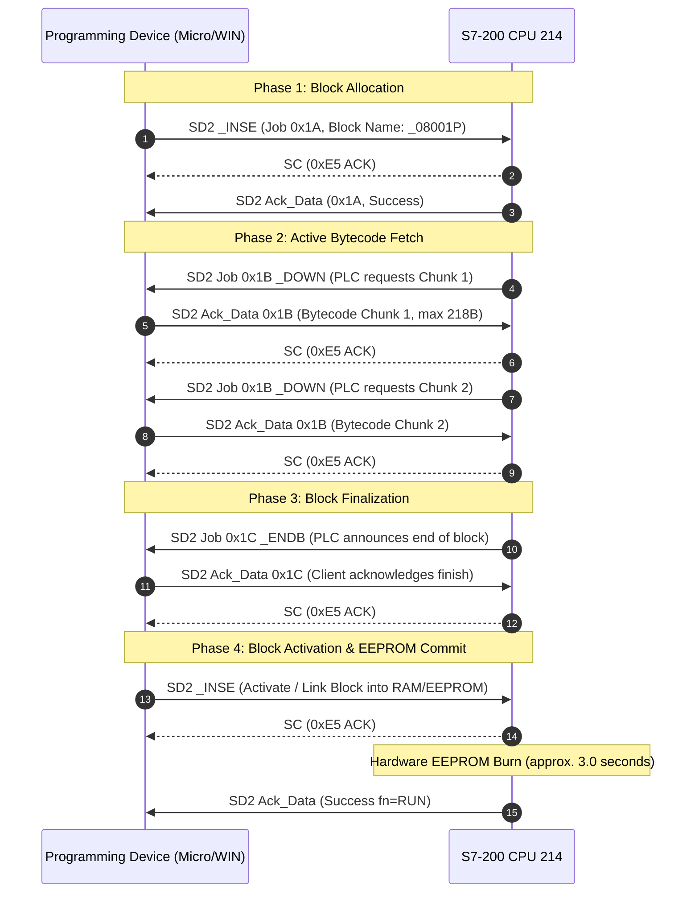

# S7-200 PPI / S7comm Protocol Specification & Architecture

This document details the reverse-engineered **Point-to-Point Interface (PPI)** protocol and **S7comm** application layer used by the **Siemens SIMATIC S7-200 (CPU 214)** for program block transfer and communications.

---

## 1. Protocol Stack Architecture

```
+-------------------------------------------------------+
|          S7comm Application Layer (Magic 0x32)         |
|   (Read/Write Variables, Block Upload/Download, Mode) |
+-------------------------------------------------------+
|             PROFIBUS FDL Data Link Layer              |
|        (SD1, SD2, SC Frames, FCB Alternation, FCS)    |
+-------------------------------------------------------+
|               RS-485 Physical Layer                  |
|          (9600 bps, 8E1, Half-Duplex, 35ms Turn)      |
+-------------------------------------------------------+
```

---

## 2. PROFIBUS FDL / PPI Frame Formats

### 2.1. SD1: Short Request / Status Poll Frame (6 bytes)
Used by the master to poll a slave or query link status.

```
+------+------+------+------+------+------+
| SD1  |  DA  |  SA  |  FC  | FCS  |  ED  |
| 0x10 | 0x02 | 0x00 | 0x4C | 0x4E | 0x16 |
+------+------+------+------+------+------+
```
* **SD1 (Start Delimiter 1):** `0x10`
* **DA (Destination Address):** `0x02` (PLC Station)
* **SA (Source Address):** `0x00` (Master Station / PC)
* **FC (Function Code):** `0x4C` (Poll request, FCV=0)
* **FCS (Frame Check Sequence):** `(DA + SA + FC) & 0xFF`
* **ED (End Delimiter):** `0x16`

### 2.2. SD2: Variable Data Frame
Used to encapsulate S7comm payloads (requests, responses, and bytecode chunks).

```
+------+----+----+------+------+------+------+-----------+------+------+
| SD2  | L  | L  | SD2  |  DA  |  SA  |  FC  | S7comm... | FCS  |  ED  |
| 0x68 | len| len| 0x68 | dest | src  | func | [Payload] | chk  | 0x16 |
+------+----+----+------+------+------+------+-----------+------+------+
```
* **SD2 (Start Delimiter 2):** `0x68`
* **L (Length):** Payload length repeated twice (`L == L`).
* **FCS:** Arithmetic sum modulo 256 of all bytes from `DA` through the end of the S7comm payload:
  $$\text{FCS} = \left( \sum_{i=4}^{N-2} \text{byte}[i] \right) \pmod{256}$$
* **ED:** `0x16`

### 2.3. SC: Short Acknowledgment (1 byte)
* **SC:** `0xE5`
* In PROFIBUS FDL, `0xE5` serves two purposes:
  1. **Immediate Link ACK:** Confirms valid physical reception of an SD2 frame.
  2. **Slave Busy / No Data:** In response to an SD1 poll, indicates the slave is still processing or has no pending data.

---

## 3. Function Code (FC) and the FCB Alternation Rule

The Function Code byte dictates transaction ordering and slave synchronization:

```
Bit:   7     6     5     4     3     2     1     0
     +-----+-----+-----+-----+-----+-----+-----+-----+
     | Res | Prim| FCB | FCV |         Function      |
     +-----+-----+-----+-----+-----+-----+-----+-----+
```
* **Bit 6 (Primary):** `1` = Master request; `0` = Slave response.
* **Bit 5 (FCB - Frame Count Bit):** Alternates `0` and `1` on consecutive new transactions.
* **Bit 4 (FCV - Frame Count Valid):** `1` = FCB alternation is active.
* **Bits 0–3 (Function):** `0x0C` (Send and Request Data High).

### Common FC Values:
* `0x5C` (`0101 1100`): Master Request with **FCB = 0**
* `0x7C` (`0111 1100`): Master Request with **FCB = 1**
* `0x4C` (`0100 1100`): Master Poll / Reset with **FCV = 0** (Ignores FCB)
* `0x08` (`0000 1000`): Standard Slave Response

> [!IMPORTANT]
> **The Slave Duplicate Rule:**  
> If an S7-200 slave receives two consecutive SD2 requests with the **same FCB** value (e.g. `0x5C` followed by `0x5C`), the standard dictates that the second frame is a redundant retransmission. The slave will discard the payload and repeat its cached previous response. Proper FCB alternation (`0x5C` $\rightarrow$ `0x7C` $\rightarrow$ `0x5C`) is strictly mandatory.

---

## 4. S7comm Application Layer Breakdown

Every S7comm frame embedded in an SD2 payload begins with the protocol header:

```
Byte 0:  0x32  (S7 Protocol ID / Magic Byte)
Byte 1:  ROSCTR (Remote Operations Service Control)
         - 0x01: Job (Request sent by client or unsolicited by PLC)
         - 0x02: Ack (Acknowledgment without data)
         - 0x03: Ack_Data (Response acknowledging a Job, containing data)
         - 0x07: UserData
Bytes 2-3: Redundancy Identification (0x0000)
Bytes 4-5: Sequence Number (Increments per request transaction)
Bytes 6-7: Parameter Length (Big Endian)
Bytes 8-9: Data Length (Big Endian)
```

### Standard S7comm Function Codes:
* `0x04`: `READ_VAR` (Read memory: Inputs, Outputs, Markers, V-Memory, Timers)
* `0x05`: `WRITE_VAR` (Write memory: Force/Set I/O or registers)
* `0x1A`: `_INSE` (PI-Service: Request block insertion / commit block activation)
* `0x1B`: `_DOWN` (Block download chunk transfer)
* `0x1C`: `_ENDB` (End of block download transfer)
* `0x1D`: `_DELE` (Query block existence / Delete block)
* `0x28`: `RUN` (Transition CPU to RUN mode)
* `0x29`: `STOP` (Transition CPU to STOP mode)
* `0xF0`: `PDU_NEG` (PDU buffer size negotiation)

---

## 5. Multi-Stage Block Download Sequence

The complete program transfer protocol follows four sequential phases:



---

## 6. S7comm Error Codes Reference

When a transaction fails, the error code is returned in bytes 17–18 of the S7comm header:

| Error Code | Description | Root Cause & Resolution |
| :---: | :--- | :--- |
| **`0x0000`** | Success | Transaction completed normally. |
| **`0xD209`** | Block already exists | Target block is currently present in CPU memory. Precede with `_DELE` (Clear PLC). |
| **`0xD230`** | Structural error in block | The compiled bytecode contains invalid opcodes, inconsistent block headers, or references to empty subroutines (`CALL SBR` with no instructions). |
| **`0xD240`** | Internal coordination violation | 1. Transfer aborted prematurely due to duplicate FCB on Chunk 1.<br/>2. An online monitoring session is currently active. |
| **`0xD201`** | Block not found | Attempted to read or delete a non-existent block. |

---

## 7. Memory Addressing & S7comm Variable Access (Read/Write)

### 7.1. Memory Area Codes (S7-200)

| Memory Area | Identifier | S7 Area Code (Hex) | DB Number Parameter | Addressing Granularity |
| :---: | :---: | :---: | :---: | :---: |
| **Physical Inputs** | `I` / `IB` / `IW` | `0x81` | `0x0000` | Bit (`0x01`) or Byte (`0x02`) |
| **Physical Outputs** | `Q` / `QB` / `QW` | `0x82` | `0x0000` | Bit (`0x01`) or Byte (`0x02`) |
| **Internal Markers** | `M` / `MB` / `MW` | `0x83` | `0x0000` | Bit (`0x01`) or Byte (`0x02`) |
| **Variable Memory** | `V` / `VB` / `VW` | `0x84` | **`0x0001` (DB1)** | Bit (`0x01`) or Byte (`0x02`) |
| **Special Markers** | `SM` / `SMB` / `SMW` | `0x05` | `0x0000` | Byte (`0x02`) |

> [!CRITICAL]
> **The S7-200 V-Memory DB1 Mapping Rule:**  
> In the S7comm protocol specification, area code `0x84` designates Data Blocks (`DB`). Because legacy SIMATIC S7-200 CPUs feature a flat Variable Memory space ($V$) rather than modular data blocks, the firmware internally maps **V-Memory exclusively to DB1** (`0x00, 0x01`).  
> * If an external client attempts to read or write area `0x84` with `DB Number = 0x0000`, the PLC immediately aborts the item with error **`0x03` (`S7COMM_ITEM_RETVAL_DATA_ACCESS_FAULT`: Accessing the object not allowed)**.  
> * Specifying `DB Number = 0x0001` resolves this 100%, returning **`0xFF` (Success)**.

### 7.2. Write Variable (`0x05`) Telegram Layout

A Write Var request payload is partitioned into an **Item Address Specification** and a **Data Section**:

```
[S7comm Header (10 bytes)]
  0x32 0x01 0x00 0x00 [SeqH SeqL] 0x00 0x0E [DataLenH DataLenL]

[Parameter Block (14 bytes)]
  0x05 (Function: Write Var)
  0x01 (Item Count: 1)
  0x12 (VarSpec Syntax)
  0x0A (Spec Length: 10 bytes)
  0x10 (Syntax ID: S7ANY)
  0x02 (Transport Size: Byte=0x02, Bit=0x01)
  0x00 0x01 (Length / Element Count: 1)
  0x00 0x01 (DB Number: 0x0001 for V-Memory; 0x0000 for I, Q, M)
  0x84 (Area Code: 0x84 for V; 0x83 for M)
  [StartBit2 StartBit1 StartBit0] (Byte offset * 8 + Bit offset)

[Data Section (5 bytes for Byte Write)]
  0x00 (Reserved Return Code in request direction - MUST be 0x00)
  0x04 (Transport Size: 0x04 = Byte/Word/DWord stream; 0x03 = Bit stream)
  0x00 0x08 (Data Length in BITS: 8 bits = 1 byte; 1 bit = 0x0001)
  [Value] (Actual byte payload: e.g. 0x01 for Start, 0x02 for Stop, 0x00 for Reset)
```

### 7.3. Item Return Status Codes in S7comm Ack_Data

| Code (Hex) | Status Name | Description / Diagnosis |
| :---: | :--- | :--- |
| **`0xFF`** | `DATA_OK` | **Success:** Item written or read successfully. |
| **`0x01`** | `DATA_HW_FAULT` | Hardware fault on the targeted module. |
| **`0x03`** | `DATA_ACCESS_FAULT` | Accessing the object not allowed (e.g. DB0 requested on S7-200, or protected area). |
| **`0x05`** | `DATA_OUTOFRANGE` | Address exceeds memory boundaries for this CPU model. |
| **`0x06`** | `DATA_NOT_SUP` | Data type / transport size not supported. |
| **`0x0A`** | `DATA_ERR` | Item or data block does not exist. |

### 7.4. CPU Operational State Detection (`SMB0`)

In SIMATIC S7-200 PLCs, byte `SMB0` contains system status flags:
* **`SM0.0` (Bit 0):** **Always ON (`1`)**. Checking this bit will erroneously report RUN even when the CPU is stopped.
* **`SM0.7` (Bit 7):** **Hardware Key Position**. `1` = Selector in `RUN`; `0` = Selector in `TERM` / `STOP`.
* **State Detection Logic:**
  1. If `SM0.7 == 1`, the CPU is in physical `RUN`.
  2. If `SM0.7 == 0` (Key in `TERM`), the CPU operational state is determined by software command (`0x28 RUN` or `0x29 STOP`) and validated by scanning output image activity (`QB0..QB1`).
